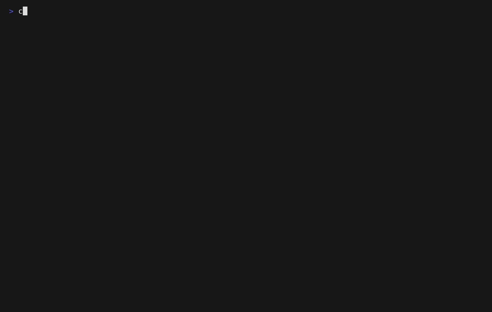

# claptap

A typing test for the terminal that looks like a terminal tool, not a web page.

Dense, boxed panels and braille graphs in the spirit of `btop`, built with
[ratatui](https://ratatui.rs). Type, get your WPM, accuracy and a per-second graph, and keep a
history of every run.



## Features

- **Time and words modes** (15/30/60/120 s, 10/25/50/100 words) with live wpm and accuracy
- **Results with a graph**: wpm, raw, accuracy, consistency, and a braille chart of your speed
  and errors second by second
- **History**: every finished test is appended to a plain JSONL file you own
- **Word lists**: English and French (200, 1k and 10k most common words), or your own lists
- **On-screen keyboard guide**: the next key, which finger to use and two drawn hands, for
  qwerty, azerty, qwertz, colemak, dvorak and qwerty-uk
- **Stratagem drill**: Helldivers-inspired arrow codes against the clock, with arrows or `hjkl`
- **Vim-flavored**: `esc` enters normal mode to change options without leaving the keyboard
- **Readable without color**: errors are underlined, struck out or reversed, not only red

claptap is younger than [ttyper](https://github.com/max-niederman/ttyper) or
[smassh](https://github.com/kraanzu/smassh); it focuses on a dense, btop-like look and on stats.
The [roadmap](docs/TODO.md) has what comes next: stats dashboard, code mode, config file, themes.

## Install

### Prebuilt binaries

Download the archive for your platform from the
[latest release](https://github.com/alexpill/claptap/releases/latest) (Linux x86_64/aarch64,
static; macOS; Windows), extract it and put `claptap` somewhere on your `PATH`.

On macOS the binary isn't signed: if it's blocked, run `xattr -d com.apple.quarantine claptap`.

### Nix

```sh
nix run github:alexpill/claptap
```

Or add the flake as an input and use `packages.<system>.default` or `overlays.default`.

### Cargo

Any Rust toolchain ≥ 1.88 works, no Nix needed:

```sh
cargo install --git https://github.com/alexpill/claptap
```

## Usage

```sh
claptap                    # 30 s test, English
claptap --time 60          # 60 s test
claptap --words 25         # type 25 words
claptap --lang french_1k   # built-in: english, french (200 words), _1k and _10k variants
claptap --stratagem        # stratagem drill: enter arrow codes against the clock
claptap --hands --layout azerty   # keyboard + hands guide: qwerty (US, default), azerty, qwertz, colemak, dvorak, qwerty-uk
```

### Keys

| Key | Action |
|-----|--------|
| `tab` | restart |
| `ctrl+backspace` (or `ctrl+w`, `alt+backspace`) | delete the current word |
| `esc` | normal mode (orange `NORMAL` badge): the option bar gets focus |
| `←→` / `hl`, `enter` | in normal mode: move, pick an option |
| `H` | in normal mode: show/hide the keyboard and hands |
| `?` | in normal mode: help |
| `esc` / `q` | in normal mode: back to typing (`INSERT`) / quit |
| `ctrl+c` | quit |

### On-screen keyboard

Opt-in: `H` in normal mode or `--hands`. Below the words, a keyboard in your layout (ANSI for
qwerty/colemak/dvorak, ISO for azerty/qwertz/qwerty-uk) lights up the next key and its finger's
zone, and names the finger to use (plus shift with the other hand for capitals, backspace when the
current word has a mistake), next to two drawn hands with the finger(s) to use filled in.
The `⌨` item in the option bar cycles the layout and lights up while the keyboard is shown;
the language item next to it cycles the word lists the same way.

### Stratagem mode

Inspired by Helldivers: a named stratagem and its arrow code show up, enter it as fast as you can
with the arrow keys or `hjkl`. A wrong input resets the code. Finish as many as possible before
the timer runs out; you get stratagems per minute, accuracy, average time and best streak (codes
entered without a mistake in a row), plus a graph of the time each one took.

### Word lists and history

Custom word lists: put whitespace-separated words in `~/.config/claptap/words/<name>.txt`
and run `claptap --lang <name>`. A file named `english.txt` or `french.txt` replaces the built-in
list. Built-in lists come from [wordfreq](words/README.md) (CC-BY-SA 4.0).

Every finished test is appended to `~/.local/share/claptap/history.jsonl` (abandoned tests are
not saved).

## Development

Plain Rust (rustup or your distro's toolchain, ≥ 1.88):

```sh
cargo run -- --words 10
cargo test
cargo clippy --all-targets -- -D warnings
```

With Nix (optional): `nix develop` gives a shell with cargo, clippy, rustfmt and rust-analyzer.
To enter it automatically with direnv, create your own `.envrc` (it is git-ignored):

```sh
echo "use flake" > .envrc && direnv allow
```

## Contributing

Bug reports, word lists and layouts are welcome. See [CONTRIBUTING.md](CONTRIBUTING.md) and the
[roadmap](docs/TODO.md). Changes are listed in [CHANGELOG.md](CHANGELOG.md).

## License

Code: [MIT](LICENSE). Built-in word lists (`words/`): [CC-BY-SA 4.0](words/README.md), from
[wordfreq](https://github.com/rspeer/wordfreq) by Robyn Speer.
